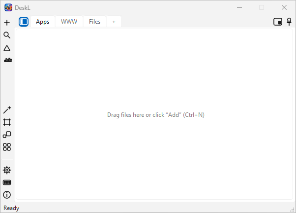

# DeskL

<p align="center">
  
</p>

<p align="center">
  
  <strong>&nbsp;Desktop Launcher — shortcuts to files, folders and websites in tabs</strong>
</p>

**DeskL** is a lightweight desktop launcher for Windows built with **Python 3** and **PyQt6**.
It keeps your shortcuts to files, folders and web links organized in tabs, with tags,
drag & drop, instant search and a lot of visual polish — always one keystroke away.

---

## ✨ Features

- 🗂 **Tabs** — group shortcuts into named tabs (`Apps`, `WWW`, `Files`, ...), add/remove/rename freely (`Ctrl+T` for a new tab).
- 🔗 **Multiple item types** — launch files, folders and URLs (each with an auto-fetched website favicon, if available).
- 🏷 **Tags** — assign a tag to every entry and filter the view with a single click.
- 🔍 **Instant search** — search by name, path or tag (`Ctrl+F`), `Esc` closes.
- 🖱 **Drag & drop** — drop files and folders onto a tab to add them; drag entries to arrange them freely.
- 🧹 **Auto arrange / align to grid** — tidy the layout in one click.
- 👁 **View modes** — Icons / List, Small / Large sizes, Grid or Auto flow.
- 📌 **Always on top & mini mode** — collapse the window to a tiny floating icon; double-click restores it.
- 🌙 **Dark mode** — full dark theme.
- 🌐 **i18n** — pluggable language packs (English 🇬🇧 and Polish 🇵🇱 included), switchable in Settings.
- 💾 **Config backup** — export / import the whole configuration as JSON (`Ctrl+E` / `Ctrl+I`).
- 🚀 **Run at system startup** — optional autostart toggle in Settings.
- 🧠 **Usage statistics** — entries count, launch counts and a *Top 10 Most Used* ranking.
- 🧷 **Broken link detection** — find and clean up all broken shortcuts at once.
- ⌨️ **Keyboard-first** — a built-in shortcuts cheat-sheet window.

## ⌨️ Keyboard Shortcuts

| Shortcut | Action |
|---|---|
| `Ctrl+N` | Add new item |
| `Ctrl+T` | New tab |
| `Enter` | Open selected item |
| `F2` / `Ctrl+E2` | Edit selected item |
| `Delete` | Delete selected item |
| `Ctrl+F` | Activate search |
| `Esc` | Close search |
| `Ctrl+E` | Export configuration (JSON) |
| `Ctrl+I` | Import configuration (JSON) |

## 🚀 Getting Started

### Requirements

- Windows (x64)
- Python 3.10+

### Installation

```bash
git clone https://example.com/deskl.git
cd deskl
pip install PyQt6
```

### Running

```bash
python DeskL.pyw
```

or just double-click `DeskL.pyw` (a windowless Python launcher).

## 📁 Project Structure

```
DeskL.pyw                 # entry point
deskl/
├── app.py                # application bootstrap / tray & floating icon
├── config.py             # configuration persistence
├── dialogs.py            # dialogs (add/edit, settings, about, ...)
├── widgets.py            # main window widget
├── utils.py              # helpers
├── core/                 # data model & operations
├── ui/                   # main UI and reusable widgets
│   └── widgets/          # tab bar, entries view, delegate, tags, float icon, ...
└── lang/                 # language plugins (en, pl)
    ├── en.py
    └── pl.py
deskl/tests/              # unit tests (search, moving entries, features)
```

## 🧪 Running Tests

```bash
python -m unittest discover -s deskl/tests
```

## 📝 License

Released under the MIT License.

## 👤 Author

**Sebastian Januchowski**
Company: polsoft.ITS™
Email: [polsoft.its@mail.com](mailto:polsoft.its@mail.com)
GitHub: [https://github.com/polsoft-it](https://github.com/polsoft-it)
